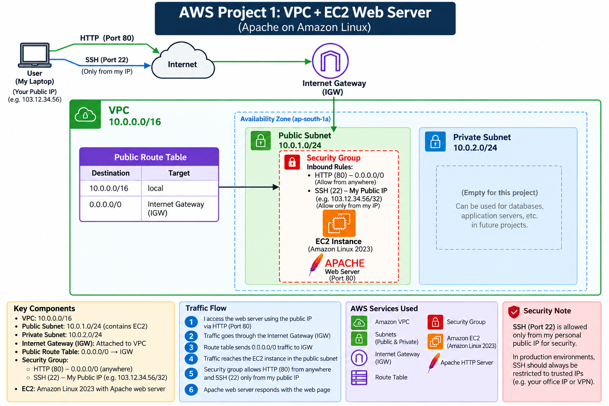

# AWS Project 1 – VPC + EC2 Web Server

## 📌 Project Overview

This project demonstrates the deployment of a basic public web server on
AWS using a custom VPC and an Amazon Linux EC2 instance.

The project covers AWS networking, EC2 deployment, Linux administration,
Apache configuration, security controls, and troubleshooting.

---

## 🏗️ Architecture



### Traffic Flow

```text
User
  ↓
Internet
  ↓
Internet Gateway
  ↓
Public Route Table
  ↓
Public Subnet
  ↓
Security Group
  ↓
EC2 Instance
  ↓
Apache Web Server
  ↓
Custom Website

```

---

## ☁️ AWS Services & Technologies

- Amazon VPC
- Public and Private Subnets
- Internet Gateway
- Route Tables
- Security Groups
- Network ACL
- Amazon EC2
- Amazon Linux 2023
- Apache HTTP Server
- Linux
- SSH

---

## 🌐 Network Configuration

| Component | Configuration |
|---|---|
| VPC | `10.0.0.0/16` |
| Public Subnet | `10.0.1.0/24` |
| Private Subnet | `10.0.2.0/24` |
| Region | Europe (Stockholm) |
| Availability Zone | `eu-north-1a` |

---

## 🔐 Security Configuration

### Security Group

| Protocol | Port | Source | Purpose |
|---|---:|---|---|
| HTTP | 80 | `0.0.0.0/0` | Web access |
| SSH | 22 | Administrator's public IP `/32` | Secure administration |

Outbound traffic was allowed for the project.

### Network ACL

The Network ACL was configured with inbound and outbound rules and
was checked during connectivity troubleshooting.

---

## 🖥️ EC2 Web Server

The EC2 instance was deployed in the public subnet using:

- Amazon Linux 2023
- `t3.micro`
- Apache HTTP Server

Apache was installed, started, and tested locally using:

```bash
curl http://localhost
```

A custom HTML webpage was then deployed and successfully accessed
through the EC2 public IP.

---

## 🧪 Validation

The following were successfully tested:

- VPC and subnet configuration
- Internet Gateway connectivity
- Route table configuration
- Security Group configuration
- EC2 instance deployment
- SSH connectivity
- Apache service
- Local HTTP response
- Public website access
- Custom HTML webpage
- Network ACL configuration

---

## 📚 Key Learning Outcomes

Through this project, I gained hands-on experience with:

- AWS VPC networking
- CIDR and subnetting
- Public vs private subnets
- Route tables and Internet Gateways
- Security Groups vs Network ACLs
- EC2 deployment
- Linux server administration
- SSH
- Apache web server
- Basic network troubleshooting

---

## 📂 Project Structure

```text
AWS-Project-1-VPC-EC2-Web-Server/
│
├── Architecture/
│   └── Project1-Architecture.png
│
├── docs/
│   └── Project1-Technical-Documentation.md
│
├── Screenshots/
│   └── Project screenshots
│
├── .gitignore
└── README.md
```

---
